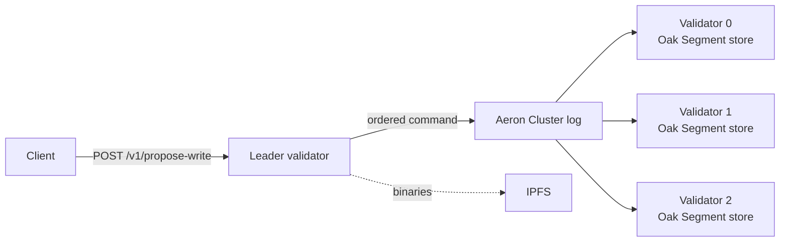

# Oak Segment Consensus

[](https://github.com/somarc/jackrabbit-oak/actions/workflows/build.yml)

The validator runtime for [Oak Chain](https://somarc.github.io/oak-chain-docs/). A
group of validators replicates one Apache Jackrabbit Oak content repository:
[Aeron Cluster](https://aeron.io/) orders every write, and each validator applies
the ordered writes to its own Oak Segment (TAR) store. Large binaries are stored
in IPFS through [`oak-blob-cloud-ipfs`](../oak-blob-cloud-ipfs/README.md).

It ships as a standalone executable JAR, built with Somarc's downstream
[Oak distribution](../README.md).

> **Status:** pre-production. A local three-validator cluster in mock payment mode
> is tested, including bounded convergence campaigns. Chain-backed payments,
> crash recovery, and production deployment are not yet validated; see
> [Maturity](#maturity).

## How it works



- **Ordering, not copying.** Validators replicate commands, not storage files. Every
  validator applies the same commands in the same order to its own store.
- **Convergence is logical.** After the same commands, validators hold the same
  nodes, property types and values. Their physical RecordIds, journal heads and
  TAR files may differ. Matching health responses or Aeron message order alone
  do not prove convergence.
- **Acceptance is not commitment.** `202 Accepted` means queued. A write is
  `COMMITTED` only after a majority of validators have applied it and flushed it
  to disk. Each accepted write is designed to end as `COMMITTED`, `FAILED` or
  `TIMED_OUT`, never silently.
- **One effect per proposal ID.** Each applied write or delete records its
  `proposalId` in a hidden, replicated index (`/:consensus/proposals`) in the
  same Oak commit as its change. A resend with the same `proposalId`, whatever
  path, content type or organization it carries, changes nothing: the leader
  answers `409` `duplicate_proposal` with the stored path, and replicated apply
  ignores any resend that reaches the log anyway.
- **Genesis is verified.** The first replicated command creates a reserved,
  digest-sealed genesis subtree, and writes are refused until every member has
  verified it.
- **Binaries are stored before they are ordered.** The leader stores an uploaded
  binary synchronously and replicates only its blob ID and IPFS CID. If the
  binary cannot be stored, the write is rejected with `503`
  `binary_upload_failed` rather than queued without it.
  Applying the write also records the blob ID and CID in a hidden, replicated
  index (`/:oak-chain-binaries`), so every validator can resolve the binary
  whichever IPFS node stored it. Changing what apply writes requires every
  validator to run the same build.

Details: [operation lifecycle](docs/OPERATION-LIFECYCLE.md) and the
[genesis and write-safety contract](docs/GENESIS-AND-WRITE-SAFETY.md).

## Quick start

### Prerequisites

- JDK 17 or 21 and Maven 3.6.1+
- [Kubo](https://docs.ipfs.tech/install/command-line/) (`ipfs`): binary storage
  defaults to IPFS, and the validator does not start without a reachable IPFS API
- Node.js 20+ to build signed test transactions with
  [`oak-chain-infra`](https://github.com/somarc/oak-chain-infra)

### 1. Build

From the repository root:

```sh
mvn -B -ntp -pl oak-segment-consensus -am package -DskipTests
```

The executable JAR is `oak-segment-consensus/target/oak-segment-consensus.jar`.

### 2. Run a single validator

Start IPFS in another terminal (`ipfs init` once, then `ipfs daemon`), then:

```sh
java --add-opens=java.base/jdk.internal.misc=ALL-UNNAMED \
  -Dconsensus.enabled=true \
  -Dhttp.bind.host=127.0.0.1 \
  -Daeron.dir="$PWD/run/aeron" \
  -jar oak-segment-consensus/target/oak-segment-consensus.jar \
  --port 8090 --store "$PWD/run/validator-0"
```

With no member list, the validator forms a one-member cluster, elects itself
leader, and writes genesis within a few seconds. Logs go to `run/logs/validator.log`.

```sh
curl -s localhost:8090/health/cluster    # "status":"UP", "hasQuorum":true
curl -s localhost:8090/v1/consensus/status
```

### 3. Write and read back

Writes must be signed. The `oak-chain` CLI builds valid test transactions with
public, deterministic test keys:

```sh
git clone https://github.com/somarc/oak-chain-infra.git
(cd oak-chain-infra && npm ci)

BODY=$(node oak-chain-infra/bin/oak-chain.mjs tx write --message 'hello, Oak Chain' --format form)
ID=$(printf '%s' "$BODY" | tr '&' '\n' | sed -n 's/^proposalId=//p')

curl -s -X POST -H 'Content-Type: application/x-www-form-urlencoded' \
  --data-binary "$BODY" localhost:8090/v1/propose-write   # 202, "state":"PENDING"
curl -s localhost:8090/v1/ops/operations/$ID              # "state":"COMMITTED" within seconds
```

The `202` response includes the `wallet` address; read the content back with
`GET /v1/wallets/content?wallet=<wallet>`.

### 4. Run a three-validator cluster

[`oak-chain-infra`](https://github.com/somarc/oak-chain-infra) owns multi-validator
launch, lifecycle, fault injection and test campaigns. Clone it next to this
repository (the scripts expect `jackrabbit-oak/` and `oak-chain-infra/` to be
siblings), then:

```sh
cd oak-chain-infra && npm ci && npm link
export CLUSTER_RUNTIME_ROOT=/tmp/oak-chain
oak-chain mock up -- --fresh --build    # build, then start three validators
oak-chain mock console                  # status, start/stop, fault injection
```

The cluster uses HTTP ports 8090, 8092 and 8094, so stop a single validator first.
The validators run the JAR straight from `oak-segment-consensus/target`; stop the
cluster before rebuilding this checkout. `--fresh` wipes the runtime root it is
given, and the scripts refuse destructive actions on the default root `~/oak-chain`
unless `OAK_ALLOW_LIVE_ROOT=1` is set. See
[mock validators](https://github.com/somarc/oak-chain-infra/blob/main/modes/mock/validators/README.md)
and [troubleshooting](https://github.com/somarc/oak-chain-infra/blob/main/modes/mock/validators/TROUBLESHOOTING.md).

## Configuration

The standalone JAR has no OSGi runtime. Configure it with command-line options,
`-D` system properties and environment variables. A system property overrides
its environment variable, except for the `oak.blockchain.*` payment settings, where
the environment variable wins. Settings listed without an environment variable are
`-D` only.

| Option | Default | |
|---|---|---|
| `--port` | `8090` | HTTP port. `port + 1` is also used by the Oak standby server. |
| `--store` | `/var/oak-chain/segmentstore-composite-mount-oak-chain` | Segment store directory. Logs go to `<parent>/logs` (`-Doak.log.dir` overrides). |
| `--help` | | Print usage. |

| Setting (`-D`) | Environment | Default | |
|---|---|---|---|
| `consensus.enabled` | | `false` | Must be `true` to accept writes. When `false`, Aeron does not start and writes return `503`. |
| `aeron.cluster.nodeId` | | `0` | This validator's index in `aeron.cluster.hostnames`. |
| `aeron.cluster.hostnames` | | single member | Comma-separated host per member; the count sets the cluster size on a fresh start. |
| `aeron.cluster.basePort` | | `9000` | Aeron uses UDP ports `basePort + 100 × nodeId + 1…7`. |
| `aeron.dir` | | Aeron default | Media driver directory prefix; the driver uses `<aeron.dir>-<nodeId>-driver`. Give each local validator its own. |
| `consensus.self.url`, `consensus.peers` | | `http://127.0.0.1:<port>`, none | This validator's HTTP URL and its peers'. Every member must be configured with the same URL set; genesis records it. |
| `http.bind.host` | | all interfaces | Bind address for every HTTP connector. |
| `oak.validator.auth.token` | `OAK_VALIDATOR_AUTH_TOKEN` | unset (auth off) | See [Security](#security). |
| `tls.enabled` | | `false` | With TLS, `--port` serves HTTPS. Also `tls.keystore.path`, `tls.keystore.password`, `tls.keystore.type` (`PKCS12`), `tls.truststore.*`, `tls.client.auth` (`none`/`want`/`need`), and `http.port` for an extra plain-HTTP connector. PEM files are rejected; convert to a keystore. |
| `oak.blob.backend` | `OAK_BLOB_BACKEND` | `ipfs` | `ipfs`, `azure` or `aws`. Legacy alias: `blobstore.type` / `BLOBSTORE_TYPE`. |
| `ipfs.api.endpoint` | `IPFS_API_ENDPOINT` | `/ip4/127.0.0.1/tcp/5001` | Kubo API multiaddr. Startup fails if it is unreachable. Validators may each run their own IPFS node in one private swarm: a binary stored through another validator's node is resolved through the replicated binary index and fetched from that node. Reading nodes do not keep a copy, so without IPFS Cluster each binary is available only while the node that stored it is. Binaries written by builds without the index can only be read through the node that stored them. |
| `ipfs.cluster.endpoint`, `ipfs.cluster.authorization` | `IPFS_CLUSTER_ENDPOINT`, `IPFS_CLUSTER_AUTHORIZATION` | unset | IPFS Cluster REST API of this validator's cluster peer, and its `Authorization` header (Basic or Bearer; prefer the environment variable). When set, a binary write is acknowledged only after the replication minimum of peers hold it, and a write that cannot reach it fails with `503 binary_upload_failed`. |
| `ipfs.cluster.replication-min`, `ipfs.cluster.replication-max`, `ipfs.cluster.pin-timeout-ms` | `IPFS_CLUSTER_REPLICATION_MIN`, `IPFS_CLUSTER_REPLICATION_MAX`, `IPFS_CLUSTER_PIN_TIMEOUT_MS` | `2`, `3`, `120000` | Peers that must hold a binary before it is acknowledged, peers that should hold it, and how long a write waits. |
| `ipfs.cluster.unpin-on-delete` | `IPFS_CLUSTER_UNPIN_ON_DELETE` | `false` | `true` lets [binary GC](#binary-garbage-collection) remove the IPFS Cluster pin of a released binary. Set it only when the IPFS Cluster serves this enterprise cluster alone: cluster pins have no owner, so unpinning drops bytes that any other user of the same CID still needs. With `false`, a released binary leaves this validator's IPFS Files index and local pin but stays pinned in the cluster. Ignored without `ipfs.cluster.endpoint`. |
| `oak.gc.binary.enabled` | `OAK_GC_BINARY_ENABLED` | `true` | Whether this validator runs [binary GC](#binary-garbage-collection): as leader it marks and proposes releases, and it deletes the records it releases. Every validator applies replicated releases regardless. |
| `oak.gc.binary.interval.ms`, `oak.gc.binary.grace.ms` | `OAK_GC_BINARY_INTERVAL_MS`, `OAK_GC_BINARY_GRACE_MS` | `86400000`, `86400000` | Time between marks (the first runs at most ten minutes after start), and how long ago a binary must last have been referenced, and its record last modified, before it is released. Keep the grace above the longest a write may wait between upload and commit. |
| `oak.gc.binary.delete.delay.ms` | `OAK_GC_BINARY_DELETE_DELAY_MS` | `600000` | How long a validator waits after applying a release before deleting the records; a record whose binary was referenced again in the meantime is kept. |
| `ipfs.encryption.keys` | `IPFS_ENCRYPTION_KEYS` | unset (plaintext) | Keyring `current;id:base64Key;...` with 32-byte keys: binaries are encrypted with AES-256-GCM before they reach IPFS. Every validator needs the same keyring, and retired keys must stay listed while binaries use them. Set it through the environment variable; the value is never reported. Gateway URLs then serve ciphertext; `/api/blob/{id}` serves plaintext. Content that a client references by an existing `ipfsCid` never passes through the validator and is not encrypted. |
| `ipfs.network.policy`, `ipfs.swarm.probe-address` | `IPFS_NETWORK_POLICY`, `IPFS_SWARM_PROBE_ADDRESS` | `warn`, unset | At startup the validator inspects its Kubo node for settings that expose content outside a private network (public bootstrap peers, public HTTP routers, AutoConf, announcing blocks, relays, QUIC/WebTransport/WebRTC listeners). `warn` logs them, `private` refuses to start unless the node is proven private, `off` skips the check. The probe address is the node's swarm listener as the validator reaches it (for example `kubo:4001`); with it, startup proves on the wire that the node uses a `swarm.key`. `private` requires it. |
| `ipfs.gateway.base`, `ipfs.local.gateway.base` | `IPFS_GATEWAY_BASE`, `IPFS_LOCAL_GATEWAY_BASE` | unset, `http://127.0.0.1:8099/ipfs/` | IPFS gateways used to build URLs in `/api/cid` responses and the `/api/cid/gateway/{id}` redirect, at read time. There is no public default: a public gateway learns every CID it is asked for and cannot reach a private swarm. Without `ipfs.gateway.base`, `/api/cid/gateway/{id}` answers `404 ipfs_gateway_not_configured`. Gateway URLs are no longer stored in content; nodes written by earlier builds keep their `ipfsGateway`. Upgrade all validators together: a build that still writes the property derives different state from one that does not. |
| `oak.blob.url.keys` | `OAK_BLOB_URL_KEYS` | unset (off) | Keyring `current;id:base64Key;...` (32-byte keys) for signed, expiring blob download URLs; see [Security](#security). Every validator needs the same keyring. Set it through the environment variable; the value is never reported. |
| `oak.blob.url.ttl-seconds`, `oak.blob.url.max-ttl-seconds`, `oak.blob.url.clock-skew-seconds` | `OAK_BLOB_URL_TTL_SECONDS`, `OAK_BLOB_URL_MAX_TTL_SECONDS`, `OAK_BLOB_URL_CLOCK_SKEW_SECONDS` | `300`, `3600`, `60` | Default and maximum lifetime of a signed URL, and the clock skew tolerated between validators; a URL stays usable for its lifetime plus the skew. Use the same values on every validator. A malformed value fails startup. |
| `oak.blob.url.required` | `OAK_BLOB_URL_REQUIRED` | `false` | `true` or `false`. With `true`, `/api/blob/{id}` serves signed URLs only (`403 blob_url_required` otherwise), and startup fails without `oak.blob.url.keys`. |
| `ipfs.api.authorization` | `IPFS_API_AUTHORIZATION` | unset | `Authorization` header for the Kubo RPC API, for example `Bearer <token>` matching Kubo's `API.Authorizations`. Set it through the environment variable: a `-D` value is visible in process listings. The value is never reported. Use an `https://` endpoint or a `/https` multiaddr to send it over TLS. |
| `ipfs.api.connect-timeout-ms`, `ipfs.api.request-timeout-ms`, `ipfs.api.max-attempts` | `IPFS_API_CONNECT_TIMEOUT_MS`, `IPFS_API_REQUEST_TIMEOUT_MS`, `IPFS_API_MAX_ATTEMPTS` | `10000`, `60000`, `3` | Kubo RPC timeouts and attempts. Transport failures and HTTP 502/503/504 are retried with backoff; uploads get one extra second per MiB. |
| `oak.segment.backend` | `OAK_SEGMENT_BACKEND` | `local` | `local`, `azure` or `aws`. Cloud backends need further settings; see [`StorageBackendConfig`](src/main/java/org/apache/jackrabbit/oak/segment/consensus/config/StorageBackendConfig.java). |
| `oak.gc.enabled` | `OAK_GC_ENABLED` | `true` | Member-local segment GC; see [Garbage collection](#garbage-collection). `false` schedules nothing and pauses Oak's compaction. |
| `oak.gc.tail.interval.ms`, `oak.gc.full.interval.ms` | `OAK_GC_TAIL_INTERVAL_MS`, `OAK_GC_FULL_INTERVAL_MS` | `86400000` (1 day), `604800000` (7 days) | How often tail and full GC run. At least `60000`; smaller values are raised. The full interval is rounded to a whole number of tail intervals. |
| `oak.gc.retained.generations` | `OAK_GC_RETAINED_GENERATIONS` | `2` | GC generations cleanup keeps. At least `2`. Sets how long remote readers can read an old head. |
| `oak.gc.force.timeout.seconds` | `OAK_GC_FORCE_TIMEOUT_SECONDS` | `0` (no forced compaction) | How long Oak may block writers to finish a compaction that cannot catch up with concurrent commits. Keep it at `0` or a few seconds: replicated writes apply on Aeron's service thread and wait for the store. |
| `oak.gc.estimation.size.delta.bytes`, `oak.gc.memory.threshold.percent` | `OAK_GC_ESTIMATION_SIZE_DELTA_BYTES`, `OAK_GC_MEMORY_THRESHOLD_PERCENT` | `1073741824`, `15` | Oak's guards: a run compacts only when the store grew by more than the delta since the last full GC (`0` always compacts), and stops when free heap drops below the threshold (`0` turns the check off). |
| `oak.blockchain.mode` | `OAK_BLOCKCHAIN_MODE` | `mock` | `mock` simulates payments. `local` (chain id 31337, epochs from the local clock) and `sepolia` (chain id 11155111) verify payments on chain and need the RPC URL and contract address. `mainnet` (chain id 1) is rejected in this version. Any other value fails startup. Checked before the store, HTTP or Aeron start. |
| `oak.blockchain.rpcUrl` | `OAK_BLOCKCHAIN_RPC_URL` | unset | Absolute `http(s)`/`ws(s)` URL with a host. At bridge start `eth_chainId` must equal the mode's chain id; a mismatch or an unreachable endpoint fails startup. |
| `oak.blockchain.contractAddress` | `OAK_BLOCKCHAIN_CONTRACT_ADDRESS` | example address | Deployed Oak payment contract. The zero and example addresses are rejected; the address must hold code. Only logs emitted by this address are accepted. |
| `oak.blockchain.contract.codehash` | `OAK_BLOCKCHAIN_CONTRACT_CODEHASH` | unset | keccak256 of the contract's deployed code (`eth_getCode`). A mismatch fails startup. Optional for `local` and `sepolia` (a warning prints the observed hash); required for `mainnet`. |
| `oak.proposal.confirmation.required` | | `0` (mode default) | Payment confirmations, counted against the latest block. `0` uses the mode default: `local` 1, `sepolia` 3; `mainnet` counts only blocks at or below the `finalized` tag. |
| `oak.consensus.safety.enabled` | | `true` | `false` stops the validator from starting; genesis v2 requires the safety invariants on every member. |
| `aeron.rcv.initial.window.length`, `aeron.socket.so_rcvbuf` | | Aeron defaults | If you set `so_rcvbuf`, make it at least the window length, or Aeron refuses to start. |

A running validator reports most of its tunables, with defaults, current values
and risk notes, at `GET /v1/config/osgi/schema` and `GET /v1/config/osgi`,
including the storage backends, bind address, Aeron port base and safety gate
above; the Aeron directory is not included. `/console/configMgr` shows the same
values read-only, next to the declared OSGi properties. The validator runs without
OSGi Configuration Admin, so the OSGi declarations document the contract and do not
set values.

## Security

- **Authentication is off unless a token is set.** With `oak.validator.auth.token`
  set, clients send the token itself, without a `Bearer` prefix, as the
  `Authorization` header. Every route except `/health*` and
  `/v1/ops/snapshots/{health,runtime,storage}` then requires it, including
  `/metrics` and `/v1/index`.
- **Token auth is untested between validators.** Validators call each other over
  HTTP (for example `/v1/aeron/cluster-state` for leader discovery) without sending
  a token, so with a token set those calls are rejected.
- **Signed blob URLs** work like S3 presigned URLs. With `oak.blob.url.keys`
  set, `GET /v1/binary/download-url/{blobId}?ttl=300` (a guarded route) returns
  `/api/blob/{blobId}?exp=…&kid=…&sig=…`, an HMAC-SHA256 signature over the
  path, expiry and key id that any validator with the same keyring accepts
  until it expires. A valid signature stands in for the token on that
  download only; an invalid or expired one is refused with `403` even when a
  token is sent. Signed downloads are served `Cache-Control: private`, with
  `Referrer-Policy: no-referrer`; signatures cover GET only. Signing restricts
  access only together with a token (who may ask for URLs) and
  `oak.blob.url.required` (no unsigned downloads). To rotate keys, add the new
  key to every validator, then make it `current`, and remove the old one after
  `max-ttl-seconds` plus the skew. Download errors name no IPFS paths or nodes;
  details are logged.
- **Bind to loopback for local work** with `-Dhttp.bind.host=127.0.0.1`. Do not
  expose a validator without a token to an untrusted network.
- **Mock mode is not payment verification.** Signatures are format-checked only and
  payments are simulated. Production use needs a reviewed security boundary, not
  just a different `oak.blockchain.mode`.

See the repository [security policy](../SECURITY.md).

## API

| Route | |
|---|---|
| `GET /v1/index` | Live list of every route this validator serves. |
| `GET /health`, `/health/local`, `/health/cluster`, `/health/deep` | Liveness and cluster health observations. |
| `GET /v1/consensus/status`, `/v1/consensus/leader`, `/v1/aeron/cluster-state` | Role, leader and Aeron cluster state. |
| `POST /v1/propose-write`, `/v1/propose-delete` | Submit signed operations; returns `202`, a `307` redirect to the leader, or `409` `duplicate_proposal` for a `proposalId` already applied or in flight. |
| `GET /v1/ops/operations/{id}` | Operation state through to `COMMITTED`, `FAILED` or `TIMED_OUT`; an applied proposal is reported `COMMITTED` from replicated state by any validator. |
| `GET /v1/wallets/content?wallet=…`, `/v1/explorer/*` | Read and browse repository content. |
| `GET /api/blob/{blobId}`, `/v1/binary/download-url/{blobId}` | Download a binary (plaintext, also when IPFS encryption is on), and issue a signed, expiring URL for it. |
| `GET /v1/ops/ipfs/health`, `/v1/ops/ipfs/verify?limit=` | IPFS node and cluster status, encryption and network settings, operation counts; and a check that stored binaries are pinned or replicated. `/health/deep` carries the status only, and `/metrics` the `oak_ipfs_*_total` counters. |
| `GET /v1/config/osgi*` | Effective configuration and its sources. |
| `GET /v1/gc/status` | This member's segment GC state; see [Garbage collection](#garbage-collection). |
| `GET /metrics` | Prometheus metrics. |

Writes and deletes are paid through the payment contract; garbage collection is not
paid and cannot be triggered over HTTP. A delete removes the content node, and Oak's
own revision GC reclaims the space; see [Garbage collection](#garbage-collection).

The governed read routes are published as an
[OpenAPI contract](https://somarc.github.io/oak-chain-docs/openapi-validator-source.yaml).
The built-in dashboard (`/`), `/explorer`, `/api-browser` and `/console/configMgr`
are local diagnostic pages; integrations should use the API rather than dashboard
badges.

Health endpoints are observations, not correctness proofs. Validators also serve
their segment files (`/segments/`, `/journal.log`, `/manifest`) for read-only
mounts; replication itself happens only through the Aeron log.

With sharding enabled, wallet prefixes owned by another cluster are read through
a read-only mount of one of its validators. While that mount is unavailable,
wallet and explorer reads under its prefixes answer `503 mount_unavailable`
rather than "not found", and the all-wallets listing is marked `partial`.
A read that fails part-way because the mount could not supply a segment also
answers 503 with `Retry-After: 1`, never a 500. The code is `mount_unavailable`
when the endpoint could not be reached; the failure counts against its circuit
breaker, so a federated mount fails over to the next member. The code is
`mount_stale` when the owner no longer holds the segment, for example after two
compactions; the mount refreshes to the owner's current head at once, so a
retry reads current content.
`/health` reports each mount under `sharding.remoteMounts` (connected,
available, circuit, revision, last refresh, last error) together with
`sharding.configDigest`, which is identical on validators configured alike.

An enterprise cluster commits its charter and federation directory through
consensus. Set `oak.federation.enterpriseId` (`OAK_FEDERATION_ENTERPRISE_ID`, a
0x-prefixed 32-byte id) on every member; the leader then proposes the charter
once after genesis, and every member reports in `/health` and the public
`GET /v1/federation` whether its configuration still matches the committed one.
A member whose settings differ refuses writes (`503 charter_mismatch`).

| Property / variable | Meaning |
|---|---|
| `oak.federation.mode` / `OAK_FEDERATION_MODE` | `mock`, `local`, `sepolia` or `mainnet`; defaults to the blockchain mode |
| `oak.federation.chainId` / `OAK_FEDERATION_CHAIN_ID` | defaults per mode: 0, 31337, 11155111, 1 (sepolia and mainnet are enforced) |
| `oak.federation.registry` / `OAK_FEDERATION_REGISTRY` | the EnterpriseRegistry address, or `static` (mock and local only) |
| `oak.federation.rpcUrl` / `OAK_FEDERATION_RPC_URL` | RPC endpoint for the registry; falls back to `oak.blockchain.rpcUrl` |
| `oak.federation.registry.codehash` / `OAK_FEDERATION_REGISTRY_CODEHASH` | keccak256 of the registry's runtime code; required on mainnet |
| `oak.federation.directoryFile` / `OAK_FEDERATION_DIRECTORY_FILE` | static directory JSON (`directoryEpoch`, `entries`) for a `static` registry |
| `oak.federation.pollMs` | how often the directory is checked (default 10000) |

The leader reads a registry at the finalized block (the latest on a `local`
chain), after checking that the RPC reports the charter's chain and the address
holds the expected code, and proposes each newer `directoryEpoch` chained after
the committed snapshot. Once a directory is committed, writes are decided from
it at ingress and again at replicated apply: a namespace may be written by its
own wallet or by its enterprise's listed writers (`namespace` request parameter),
only on the cluster of the enterprise that owns it, and only while that
enterprise is `ACTIVE`; other clusters' namespaces answer `307 wrong_cluster`.

Once a federation directory is committed, it replaces those static routes: each
namespace of every `ACTIVE` enterprise other than the local charter's is mounted
read-only at its address root (`/oak-chain/XX/YY/ZZ/0x<address>`); local and
unclaimed paths stay on the local store. Reads use the first of the enterprise's
listed endpoints whose `GET /v1/federation` reports the entry's `enterpriseId`
(and `clusterId`, when the entry pins one), whose breaker is closed and that is
connected, and fall over in order; an endpoint is checked again after its breaker
resets. The validator polls the committed directory every `oak.federation.pollMs`,
rebuilds the read view when it changes and swaps it in place. `/health` then
reports `sharding.mountSource: directory`, the `directoryEpoch`, and per mount
the `enterpriseId`, `namespaces`, `endpoints`, `activeEndpoint` and `verified`.

Each remote enterprise is one Oak mount listing all of its namespace roots.
Oak's `SimpleMountInfoProvider` resolves a path by scanning every mount, and a
composite root reads every mount's root, so both costs grow with the number of
remote enterprises; within one mount the lookup is a sorted-set search over its
namespace roots. Listing the children of a node above a mounted namespace (`/`,
`/oak-chain` or a shard level) still scans every mounted namespace root once
(`MountInfo.isDirectlyUnder`), linear in the total number of remote namespaces.

## Garbage collection

Each validator runs Oak's online revision GC on its own segment store. GC is
member-local and has nothing to do with payments or Ethereum: there is no vote,
no replicated decision and no HTTP trigger. Members' stores already differ
physically (segment ids are random), and GC does not change the content, so
there is nothing to agree on.

- **What runs.** Oak's `FileStore.tailGC()` and `fullGC()`: estimation,
  compaction, then cleanup of segments older than `retainedGenerations`. Tail GC
  runs every tail interval (daily) and full GC every full interval (weekly), on
  a dedicated daemon thread, one run at a time. A slot that falls due for both
  runs full GC only. Oak's guards stay on: a run is skipped when estimation finds
  too little growth, when memory is low, or within `oak.gc.backoff` (10 hours)
  of the last successful run.
- **Staggered.** Runs happen in wall-clock slots. Member *i* of *n* (its
  `aeron.cluster.nodeId` and the configured Aeron membership; 0 of 1 without
  Aeron) runs at an offset of *i* × interval / *n*, so with the defaults three
  members run at 00:00, 08:00 and 16:00 UTC and at most one compacts at a time.
  Slots are anchored to the clock, not to start-up, so restarts keep the stagger;
  the first run is the first slot at least 15 minutes after start-up. A run
  waits until genesis is committed (it is recorded as skipped until then).
- **Writers are not stalled.** Replicated writes apply on Aeron's service thread
  and need the store's head. Oak's last compaction phase can force its way in by
  blocking all writers for up to `forceTimeout` seconds (Oak's default is 60).
  The validator sets it to 0, which Oak treats as "never force": a compaction
  that cannot catch up with concurrent commits after its retries gives up,
  cleanup still runs, and the next slot tries again. Merges keep landing during
  compaction.
- **Remote readers.** Every compaction, tail or full, starts a new generation,
  and cleanup removes non-compacted segments `retainedGenerations` generations
  old. A head that another cluster has mounted therefore stays readable for
  about `readerWindowMs` = shorter interval × (`retainedGenerations` − 1), one
  day with the defaults. `GET /v1/federation` publishes it in its `gc` block
  (`retainedGenerations`, `tailIntervalMs`, `fullIntervalMs`, `readerWindowMs`).
  A mount refreshes far more often (`oak.federation.pollMs`), and a read that
  still hits a removed segment answers `503 mount_stale` and refreshes.
- **Status.** `GET /v1/gc/status` returns `{"segment": …, "binary": …}`; the
  same object is the `gc` block of `/health` and `/health/deep`. `segment` holds
  the settings, the member index, count and offset, the head's GC generation
  (`full`, `generation`, `compacted`), Oak's current phase (`oakStatus`), the run
  in progress, the last tail and full run (start and finish times, `completed`,
  `skipped`, `failed` or `cancelled`, reclaimed bytes, store size before and
  after, and the reason or error) and the next tail and full run. `binary` is
  `null` until binary GC reports.

Shutdown cancels a run in progress through Oak's own cancellation before the
store closes. Oak records each cleanup in `gc.log` in the store directory.

## Binary garbage collection

Binary GC reclaims IPFS space for binaries that no content references any more. It
runs without payment, votes or an HTTP trigger, and is on by default.

1. **Reference stamps.** Every replicated write that stores or references an indexed
   binary stamps its entry in the replicated binary index
   (`/:oak-chain-binaries/<aa>/<bb>/<sha-256>`) with the entry's log position
   (`refPosition`) and cluster time (`refTime`). Entries written before the stamps
   existed read as 0. A write that names a client `ipfsCid` stores a binary
   reference when the validator's CID mappings and the replicated index both know
   that CID, so the bytes stay referenced; any other `ipfsCid` stays a string, as
   before, and is never released.
2. **Mark (leader).** Every `oak.gc.binary.interval.ms`, the leader reads its
   applied watermark and the index from one root, flushes and collects the blob
   references of its segment store (every generation it still retains), and
   proposes `BINARY_RELEASE` entries (template 118, at most 1000 ids each) for index
   entries that nothing references, last referenced before the watermark entry and
   longer ago than `oak.gc.binary.grace.ms`.
3. **Release (every member).** Applying the release removes each listed entry that
   still exists and was last referenced before the mark, in one merge with the
   applied watermark; entries referenced since are skipped. Replay below the
   watermark skips the release, like every other store command.
4. **Delete (every member, local).** After `oak.gc.binary.delete.delay.ms`, on its
   own thread, each validator deletes its DataStore record of every released
   binary, unless the binary was referenced again, its record was modified after
   the mark's grace bound (an upload of the same bytes on its way to the log), or
   the validator does not hold it. With IPFS this unpins only what the validator
   stored, and removes the IPFS Cluster pin only with
   `ipfs.cluster.unpin-on-delete`. Failures are logged and counted, never retried
   and never affect replicated state; the CID mapping of a deleted record is
   dropped, so the CID is no longer accepted as a known client CID.

Bytes leave a deleted binary only after Oak's segment GC has dropped the
generations that still reference it: typically two full compactions with cleanup.
IPFS blocks are reclaimed by Kubo's own GC; run Kubo (and IPFS Cluster peers) with
`ipfs daemon --enable-gc` or set `Datastore.GCPeriod`. The validator does not call
`repo/gc`.

`GET /v1/gc/status` reports it under `binary` (null when disabled): settings, `nextMarkAt`, `lastMark` (`at`, `markedAtPosition`,
`references`, `candidates`, `proposed`, `error`), `lastRelease` (`at`, `position`,
`markedAtPosition`, `released`, `skipped`) and `deletes` (`ok`, `failed`,
`pending`, `skippedRecent`, `skippedReferenced`, `absent`).

## Build and test

```sh
mvn -B -ntp -pl oak-segment-consensus -am verify -DskipITs
```

This runs the module and dependency unit tests, packaging, license (RAT) and
bundle baseline checks; CI runs it on JDK 17 and 21. It does not exercise a live
cluster. A fresh build needs at least the `package` phase, because
`oak-shaded-guava` produces its relocated artifact there.

For a build whose JAR you will cite as evidence, start from a clean checkout and
stamp the source revision into the manifest:

```sh
test -z "$(git status --porcelain)"
mvn -B -ntp -pl oak-segment-consensus -am verify -DskipITs \
  -Doak.source.revision="$(git rev-parse HEAD)" -Doak.source.dirty=false
```

The manifest then records the Somarc version, the pinned Apache revision, the
source revision and dirty state; unstamped builds say `unrecorded` and `unknown`.
Keep the JAR's SHA-256 with the test record.

The module version is `2.7.0-somarc-SNAPSHOT`, on the Oak `2.7-SNAPSHOT` baseline.
It is a development build, not an Apache artifact or a published Somarc release.
The module is also packaged as an OSGi bundle, but that bundle depends on this
fork's Segment Tar exports and is not a drop-in for stock Apache Oak or AEM.

## Maturity

**Demonstrated:** unit and package gates on JDK 17 and 21; a bounded three-validator
mock-mode campaign (39 assertions) in which writes reached `COMMITTED` and the typed
repository state converged on every validator. The
[promotion record](../docs/PRODUCT-PROMOTION.md#validation-record) lists the
evidence and its limits.

**Not yet validated:** crash and restart recovery, quorum loss and partitions,
chain-backed payments and signed-intent binding, cloud storage backends, independent
IPFS replication, dynamic membership, cross-cluster deployments, and garbage
collection. Cluster-wide proposal idempotency (one effect per `proposalId`) is
implemented and unit-tested but not yet validated on a live cluster. Status records
for proposals still in flight live only on the validator that accepted them;
applied proposals are answered from replicated state.

Each kind of evidence stands on its own: unit tests, bounded multi-validator
convergence, fault and recovery runs, and chain-backed or production evidence. A
pass in one does not establish another. Live-cluster tests follow the
[consensus test charter](https://github.com/somarc/oak-chain-infra/blob/main/modes/mock/validators/tests/CONSENSUS-TEST-CHARTER.md).

## Contributing

See [CONTRIBUTING.md](../CONTRIBUTING.md). Product authority and scope are defined
in the [fork contract](../docs/FORK-MAIN-CONTRACT.md), and upstream Apache changes
arrive through the [sync runbook](../docs/FORK-UPSTREAM-SYNC-RUNBOOK.md).
`oak-auth-web3` and `oak-segment-agentic` are deferred and not part of this product.

## License

[Apache License 2.0](../LICENSE.txt). Keep [NOTICE.txt](../NOTICE.txt) when
redistributing. This is Somarc's downstream distribution, not an official Apache
release.
