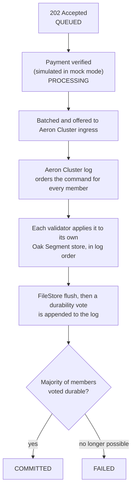
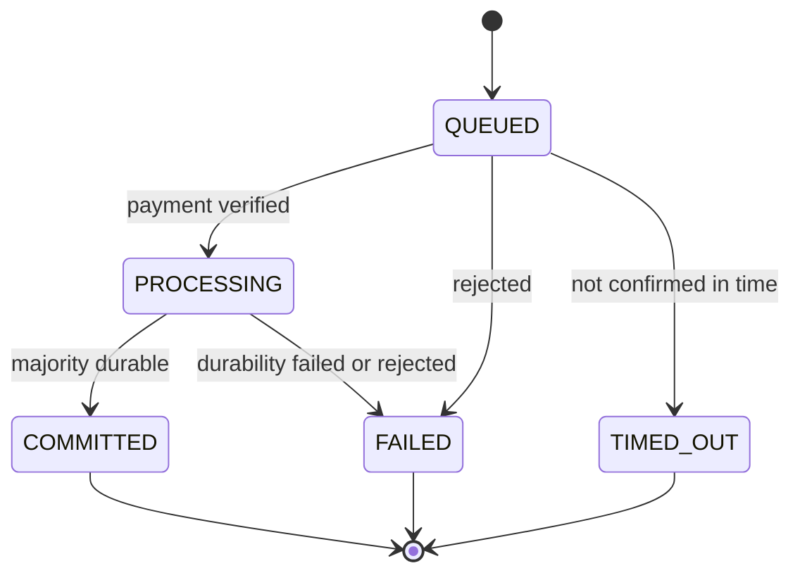

# Operation lifecycle

How a write or delete moves from an HTTP request to a committed, replicated
repository change, and how to read its status. Behavior described here is what
the current code does; [GENESIS-AND-WRITE-SAFETY.md](GENESIS-AND-WRITE-SAFETY.md)
is the normative safety contract it implements.

## Submission

Clients send `POST /v1/propose-write` or `POST /v1/propose-delete` to any validator.
The request carries a wallet address, a client-chosen 32-byte `proposalId`, an
`ethereumTxHash` and a wallet signature. The field rules are specified by the
[transaction contract](https://github.com/somarc/oak-chain-infra/blob/main/modes/mock/TRANSACTION-CONTRACT.md),
and `oak-chain tx write|delete` in `oak-chain-infra` builds conformant requests.

Before queueing, the receiving validator answers immediately when it cannot accept
the request:

| Response | Meaning |
|---|---|
| `307` with `Location`, `code=wrong_leader` | This validator is a follower. Resend to the leader. Followers never forward. |
| `503`, `code=leader_unknown`, `Retry-After: 1` | No leader is known yet. Retry. |
| `503` | The cluster is unhealthy, including before genesis is verified on every member. |
| `400` / `401` / `403` / `422` | Malformed fields, a failed signature check outside mock mode, a reserved or unregistered wallet, or an unusable `ipfsCid`. |
| `409`, `code=duplicate_proposal` | The `proposalId` has already taken effect (`answeredFrom=replicated-state`, with its `path`, `kind` and `appliedAt`) or is still in flight on this leader (`answeredFrom=leader-queue`). Poll its status instead of resending. |
| `202 Accepted` | Queued on the leader. **Not yet committed.** |

A `proposalId` has one effect, ever. Each applied write or delete records it in
the replicated index `/:consensus/proposals/<id[2..4]>/<id[4..6]>/<id>` (`kind`,
`path`, and the cluster-log time `appliedAt`) in the same Oak commit as its change;
ids are 32-byte hex and are compared case-insensitively. The leader refuses a
resend with `409`; a resend that still reaches the log (two concurrent requests, or
one accepted by a previous leader) is applied by no member: each acknowledges it as a
duplicate without changing the repository. A different path, content type or
organization does not make a resend a new proposal. A delete records its id even
when its target is already gone, so resending it cannot delete a node created later.
A proposal that was rejected or failed without effect may be resent.

In mock mode (the default) payment is simulated and only the signature's format is
checked; outside mock mode the signature is verified at entry and again before
replication.

## From queue to commit

- Every member applies the same commands in the same log order. A member that cannot
  apply a valid command stops rather than diverge.
- A member votes durable only after a FileStore flush that covers the application.
  `COMMITTED` therefore means a **majority** (`members / 2 + 1`) of validators applied
  and flushed the change, not necessarily all of them.
- If the leader loses leadership while sending, the send is retried and then ends as
  `FAILED` or `TIMED_OUT`; it is never silently dropped.

## Reading status

Poll `GET /v1/ops/operations/{proposalId}` on **the validator that returned `202`**.
Its ledger of queued proposals is local to that validator, and terminal records are
kept for 10 minutes (`oak.proposal.processed.retention.ms`). When a validator's
ledger does not hold the proposal (it was accepted by a previous leader, or the
record has expired) but its repository records the proposal as applied, it answers
`state=COMMITTED`, `sourceState=APPLIED`, `answeredFrom=replicated-state` and the
`path`, with `durabilityState` from the replicated durability tally while it still
tracks the proposal (`UNKNOWN` afterwards). Any validator can answer this way; a
proposal that is neither queued there nor applied returns `404`.

| `state` | Terminal | Meaning |
|---|---|---|
| `QUEUED` | no | Accepted, waiting for payment verification. |
| `PROCESSING` | no | Verified, being replicated, or awaiting durability votes. |
| `COMMITTED` | yes | Applied and flushed by a majority of validators. |
| `FAILED` | yes | Rejected, or durability can no longer reach a majority. See `error`. |
| `TIMED_OUT` | yes | Not confirmed within `oak.proposal.confirmation.timeout.ms` (default 300 s). Retryable. |

The response also carries the underlying fields `sourceState` and `durabilityState`.
`GET /v1/proposals/{id}/status` returns only those raw fields:

| `sourceState` | `durabilityState` | Operation `state` |
|---|---|---|
| `PENDING` | any | `QUEUED` |
| `VERIFIED` | any | `PROCESSING` |
| `PROCESSED` | `PENDING` | `PROCESSING` |
| `PROCESSED` | `ACKED` | `COMMITTED` |
| `PROCESSED` | `FAILED` | `FAILED` |
| `REJECTED` | any | `TIMED_OUT` if the reason is a timeout, otherwise `FAILED` |

`PROCESSED` means the command was offered to the Aeron log, not that it committed.
Only the operation `state` expresses the commit outcome. The operation `type` is
currently reported as `WRITE_PROPOSAL` for deletes as well, except in answers from
replicated state, which report `DELETE_PROPOSAL`. Those answers use
`sourceState=APPLIED`, which is not one of the queue states above.

## Genesis

A newly elected leader that finds no genesis sends a parameter-free `CREATE_GENESIS`
as the first replicated command. Writes return `503` until every member has
verified genesis. See [GENESIS-AND-WRITE-SAFETY.md](GENESIS-AND-WRITE-SAFETY.md).

## Roles

Each validator is an Aeron Cluster member and is either `LEADER` or `FOLLOWER`.
`GET /v1/consensus/leader` and `GET /v1/consensus/status` (`isLeader`,
`currentLeader`) report the current leader. Clients do not need to discover it in
advance: follow `307` redirects, retry `leader_unknown`, and poll status on the
validator that accepted the request.

## Garbage collection

GC is not paid and has no endpoints. A delete removes the content node in its
replicated merge, and Oak's own revision GC on each member will reclaim the space;
it is not yet scheduled. Aeron logs and snapshots written before the paid-GC market
was retired may hold GC proposal, vote and execute entries (templates 103-105) and
GC proposal snapshot frames (115). Members accept and ignore them, and those ids
are never reused.
